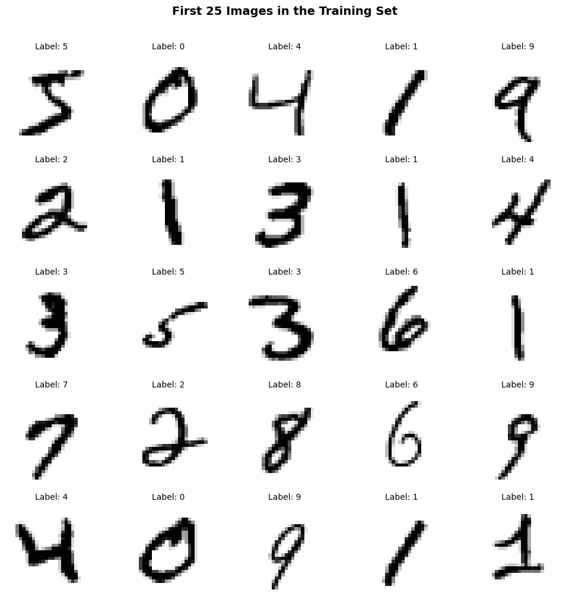
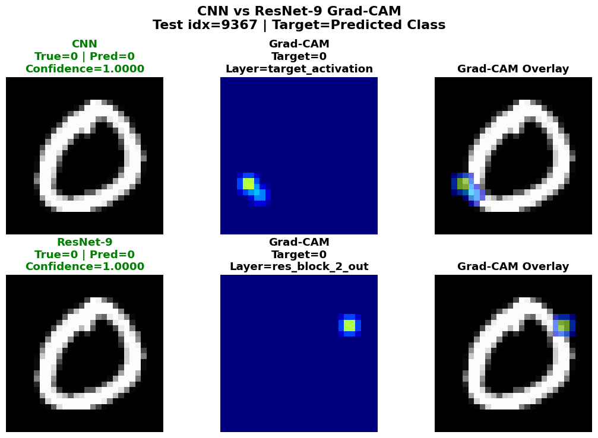

# MNIST Model Comparison & Explainable AI

Compare **seven handwritten-digit classifiers** on MNIST, from classical machine learning to convolutional networks and a Vision Transformer. This project reorganizes `AI-Final.ipynb` into reusable source code, a CLI, tests, and local setup instructions.

[Methodology](docs/methodology.md) · [GitHub instructions](docs/github.md) · [Historical notebook results](reports/notebook/README.md)



## Features

- EDA: class distribution, sample and mean images, pixel distribution, and sparsity.
- KNN, StandardScaler + SVM, Random Forest, MLP, CNN, custom mini ResNet-9, and Tiny-ViT with 49 patches and two Transformer blocks.
- Optuna tuning for learning rate, dropout, batch size, and filter/hidden-unit counts.
- Accuracy, macro and weighted F1, classification reports, confusion matrices, and runtime.
- Nearest-neighbor examples, RF feature importance, SVM occlusion, saliency, Integrated Gradients, Grad-CAM, attention rollout, and deletion tests.
- Model save/load, inference on your own images, and explanation figures.

## Installation

Use Python **3.11–3.13**. The local validation environment used Python 3.13.5, TensorFlow 2.21.0, NumPy 2.4.1, and scikit-learn 1.8.0. CI is configured for Python 3.11 and 3.13 on Ubuntu.

On Windows PowerShell, open a terminal in the project directory:

```powershell
python -m venv .venv
.\.venv\Scripts\python.exe -m pip install --upgrade pip
.\.venv\Scripts\python.exe -m pip install -r requirements.txt
.\.venv\Scripts\Activate.ps1
```

If PowerShell blocks activation, use `.\.venv\Scripts\python.exe` instead of `python` in the commands below.

On Linux/macOS:

```bash
python3 -m venv .venv
source .venv/bin/activate
python -m pip install --upgrade pip
python -m pip install -r requirements.txt
```

For the basic CLI only, install with `python -m pip install -e .`. Add `.[research]` for tuning or `.[notebook]` for Jupyter. Recent TensorFlow runs on CPU on native Windows; NVIDIA GPU users should use Linux/WSL2 per the [TensorFlow installation guide](https://www.tensorflow.org/install/pip).

## Quick start

The first run needs Internet access to download MNIST (about 11 MB) into `data/raw/`. This small run checks the workflow; it is not a full benchmark:

```bash
python -m mnist_project train --model cnn --epochs 1 --train-limit 2000 --test-limit 500 --output artifacts/cnn-quick
```

Train all seven models; deep models default to 15 epochs:

```bash
python -m mnist_project train --model all --config configs/default.json --output artifacts/full-run
```

Full-data SVM/KNN can take a long time on CPU. Each model is saved in its own subdirectory. Commands refuse to overwrite nonempty experiment directories, so choose a new output path for each run. Omit `--output` during training to generate a timestamped name.

```bash
python -m mnist_project eda --output artifacts/eda-run
python -m mnist_project evaluate --run artifacts/cnn-quick --output artifacts/cnn-evaluation.json
python -m mnist_project --help
```

To run offline with a downloaded MNIST file, add `--data data/raw/mnist.npz` to `train`, `tune`, or `eda`. When moving an experiment to another machine, `evaluate` also accepts `--data` to update the dataset path.

## Optuna tuning

```bash
python -m mnist_project tune --model cnn --trials 5 --epochs 10 --output artifacts/cnn-search
python -m mnist_project train --model cnn --params artifacts/cnn-search/best_params.json --epochs 15 --output artifacts/cnn-tuned
```

`tune --model` accepts `mlp`, `cnn`, `resnet9`, or `tinyvit`. Tuning uses only training and validation data. When training from tuning results, keep the same `--seed`, `--validation-size`, and `--train-limit` if you changed them; the CLI does not copy split options from the tuning file.

## Prediction and explanations

Input images should be bright centered digits on a black 28×28 background. The CLI converts to grayscale, resizes while preserving aspect ratio, and pads the image. Use `--invert` for white backgrounds. Real-world photos with complex backgrounds may need more preprocessing.

```bash
python -m mnist_project predict --run artifacts/cnn-quick --image path/to/digit.png
python -m mnist_project explain --run artifacts/cnn-quick --image path/to/digit.png --method gradcam --output artifacts/cnn-gradcam
python -m mnist_project explain --run artifacts/cnn-quick --image path/to/digit.png --method ig --target 7 --steps 32 --output artifacts/cnn-ig
```

`--images-npy` accepts a batch of uint8 NumPy images in `[0,255]` or float images in `[0,1]` instead of `--image`. `explain` uses the first image in the batch. `--method auto` selects:

| Model | `--model` | Default explanation |
|---|---|---|
| KNN | `knn` | Three nearest neighbors |
| SVM | `svm` | Decision-score occlusion |
| Random Forest | `random_forest` | Global pixel importance |
| MLP | `mlp` | Integrated Gradients |
| CNN | `cnn` | Grad-CAM |
| Custom mini ResNet-9 | `resnet9` | Grad-CAM |
| Tiny-ViT | `tinyvit` | Attention rollout |

Deep models also support `ig` and `saliency`; `attention` is for Tiny-ViT and `gradcam` for CNN/ResNet. IG also saves an illustrative single-image deletion test. Attention is not a causal explanation, RF importance is global, and SVM decision scores are not probabilities.



## Project structure

```text
mnist-model-comparison/
├── .github/workflows/ci.yml
├── configs/default.json
├── data/README.md
├── docs/
│   ├── architecture.md
│   ├── methodology.md
│   ├── github.md
│   └── validation.md
├── notebooks/
│   ├── AI-Final.ipynb        # Historical reference; outputs cleared
│   └── 01_workflow.ipynb     # Package workflow tutorial
├── reports/notebook/        # Figures and results from original outputs
├── src/mnist_project/
│   ├── data.py
│   ├── models.py
│   ├── vit.py
│   ├── experiments.py
│   ├── tuning.py
│   ├── explain.py
│   ├── eda.py
│   └── cli.py
├── tests/test_project.py
├── tools/prepare_notebooks.py
├── artifacts/               # Large data, models, and outputs excluded from Git
├── pyproject.toml
├── requirements.txt
├── requirements-tested.txt
├── CONTRIBUTING.md
├── README.en.md
└── README.md
```

Each experiment saves `model.keras` or `model.joblib`, `config.json`, `split_indices.npz`, `metrics.json`, `history.json`, `predictions.npy`, `confusion_matrix.png`, and `comparison.csv`. Deep models also save `learning_curves.png`. The config records the seed, sample counts, dataset path, and library versions. Load only artifacts you created or trust.

## Historical results

These numbers were **extracted from saved outputs in the original notebook**. They are not results of rerunning the new pipeline:

| Model | Original accuracy | Note |
|---|---:|---|
| KNN | 97.05% | Official test, 10,000 images |
| SVM | 95.96% | Official test, 10,000 images |
| Random Forest | 94.77% | Official test, 10,000 images |
| Tuned MLP | 97.57% | 7,000-image test after combining and resplitting data |
| CNN | 99.43% | Official test, 10,000 images |
| Custom ResNet-9 | 99.48% | Official test, 10,000 images |
| Tiny-ViT | 97.83% | Validation overlapped original training data |

The new pipeline uses a consistent **54,000 train / 6,000 validation / 10,000 test** split, fixes Tiny-ViT validation overlap, and correctly saves positional embeddings. Because the protocol and some defaults changed, its metrics may differ from historical numbers. See [methodology](docs/methodology.md).

## Notebooks and tests

```bash
python -m jupyter lab
python -m unittest discover -s tests -v
python tools/validate_notebooks.py
python -m build
```

Open `notebooks/01_workflow.ipynb` for the new workflow. `AI-Final.ipynb` preserves the historical research logic with outputs and execution counts removed. Read its opening note before running it because its original data split limitations remain.

Offline tests use small fixtures and train one epoch. They save/load all seven models and check data splitting, the CLI, and XAI. These are operational tests, not evidence of MNIST prediction quality. See the [validation report](docs/validation.md).

## GitHub and license

Follow [GitHub instructions](docs/github.md) to create and push a repository. No distribution license has been selected; the owner may add an appropriate `LICENSE`. Do not assume a license for third-party datasets or notebooks.