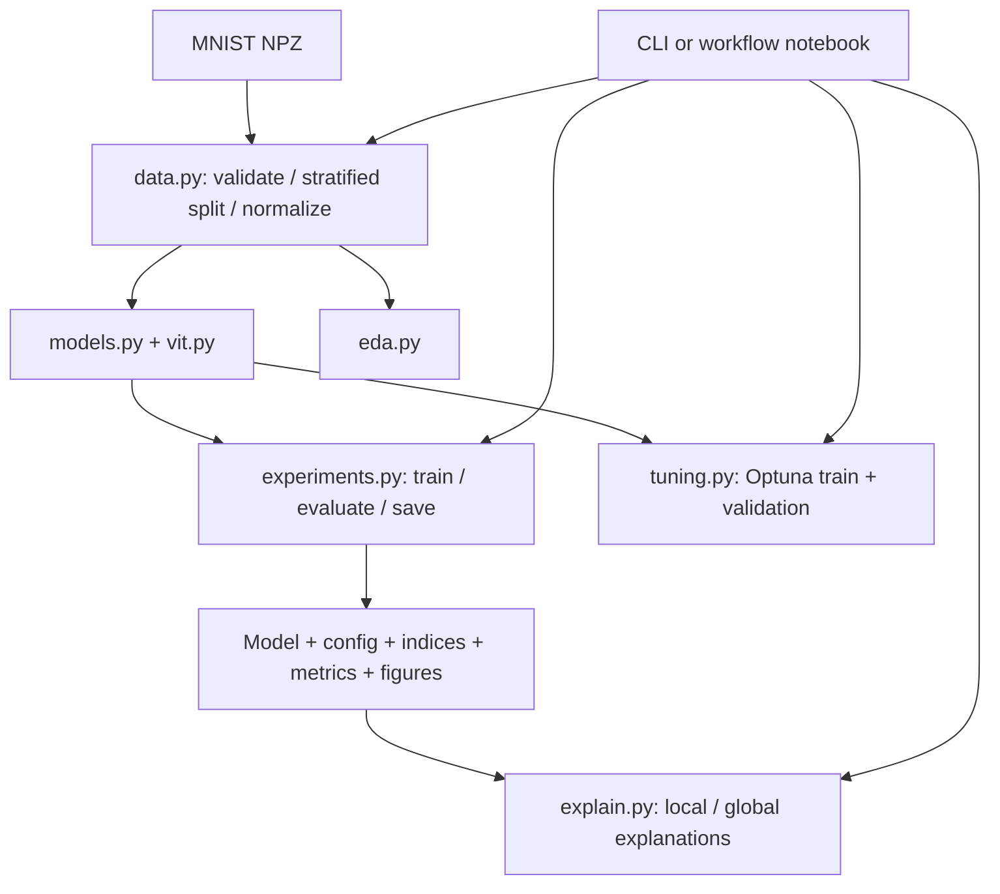

# Architecture

`data.Dataset` holds the partitions, indices into the source dataset, and split metadata. `model_input` selects either a 784-dimensional vector or a 28×28×1 tensor. The `build_model` factory creates the same architecture for tuning and training.

`run_experiment` manages one complete run for one model. The CLI's `train --model all` uses the same runner and Dataset, then aggregates `comparison.csv`. Existing experiments are not overwritten. An interrupted run may leave incomplete artifacts; use another output directory to rerun it.

`config.json` stores input values, sample counts, and library versions. `split_indices.npz` stores train/validation/test indices associated with the source dataset. If the dataset is moved, `evaluate` accepts a new path; the replacement must contain the same samples in the same order. Training cannot currently be resumed or cached.

Classical ML models are saved with joblib and deep models with Keras. Importing `mnist_project.vit` registers the custom layer before loading a `.keras` file; the CLI does this automatically.

There is no API server, user account, database, or OpenAI API key requirement.