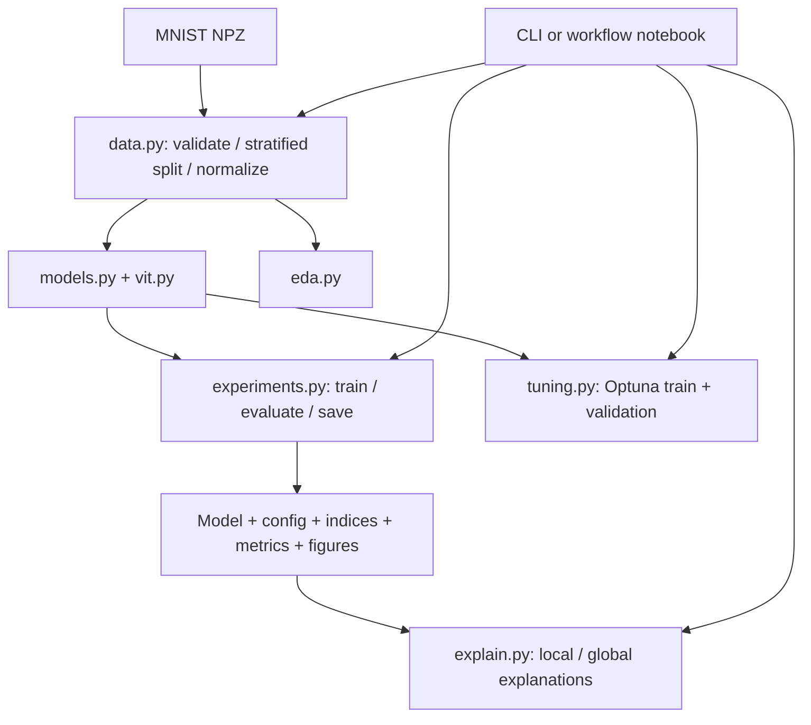

# Kiến trúc

`data.Dataset` mang các partition, chỉ số trong dataset nguồn và thông tin
chia dữ liệu. `model_input` chọn vector 784 chiều hoặc tensor 28×28×1.
Factory `build_model` tạo cùng kiến trúc cho tuning và train.

`run_experiment` quản lý trọn một lần chạy của một model. CLI `train --model
all` gọi cùng runner với chung Dataset và tổng hợp comparison.csv.
Không ghi đè experiment đang tồn tại. Artifact sau lỗi giữa chừng có thể chưa
đầy đủ; đổi output directory để chạy lại.

`config.json` chứa các giá trị đầu vào, sample counts và phiên bản thư viện.
`split_indices.npz` lưu chỉ số train/val/test gắn với đúng file dataset nguồn.
Nếu di chuyển dữ liệu, evaluate nhận đường dẫn mới; file mới phải là cùng
dataset và giữ nguyên thứ tự mẫu. Chưa có cơ chế resume hoặc cache training.

ML models lưu joblib, deep models lưu Keras. Import `mnist_project.vit` đăng
ký custom layer trước khi đọc file `.keras`. CLI thực hiện việc đó tự động.

Không có API server, tài khoản, database hay yêu cầu OpenAI API key.
